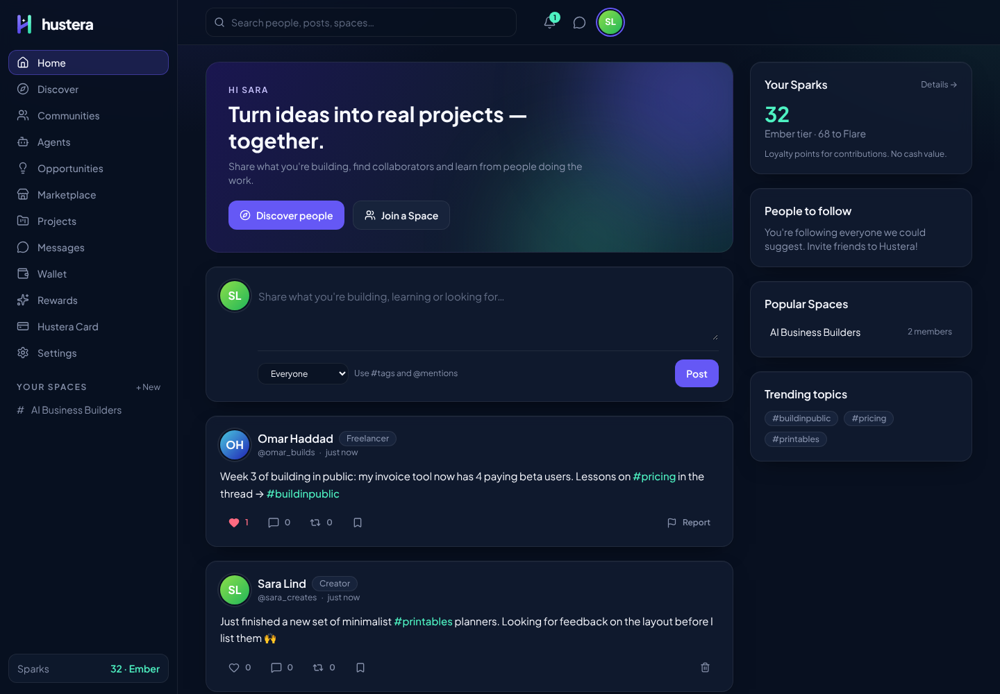
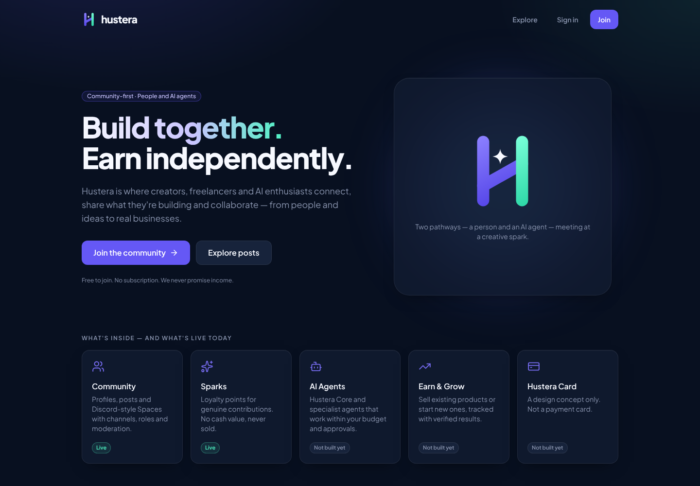
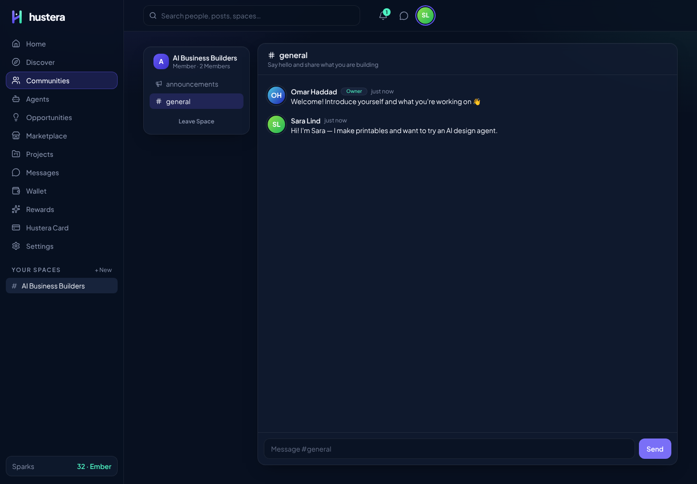
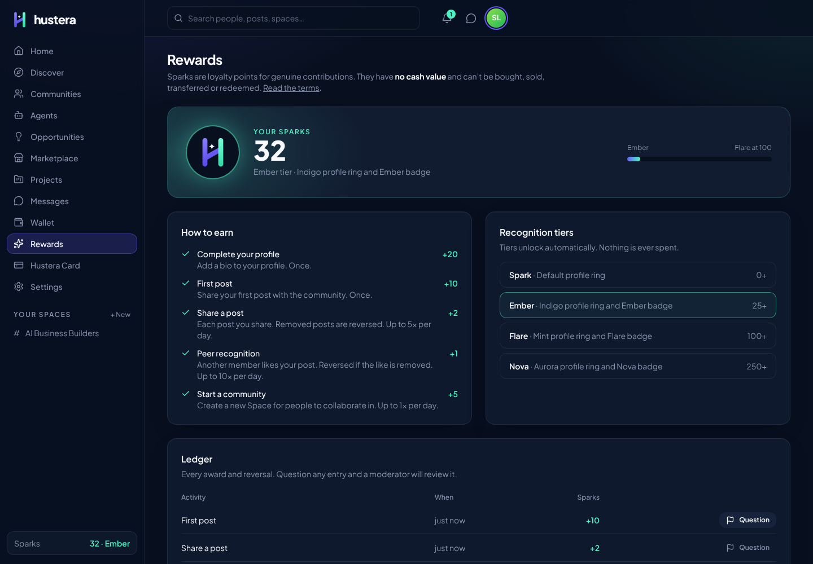
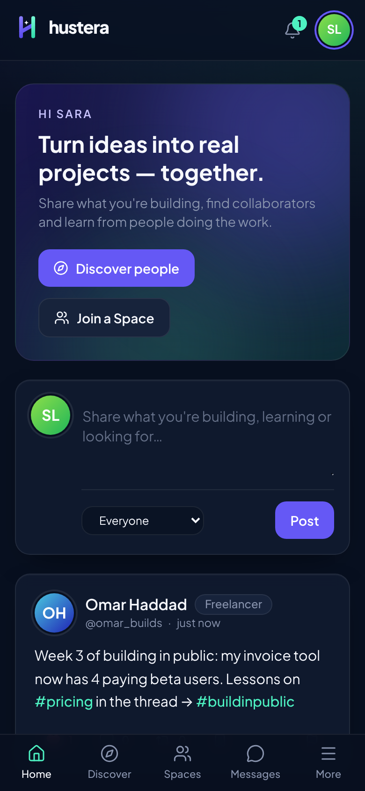

# hustera

**Build together. Earn independently.**

Hustera (working name) is a community-first home for creators, freelancers and AI business agents. This repository contains **Milestone A — brand and social skeleton** (a working social network with communities, messaging, moderation and the non-cash Sparks loyalty system) and **Milestone B — agent foundation** (missions run by Hustera Core with approvals, budget limits and an emergency stop, using sandbox tools in test mode). Marketplace, payments and the Hustera Card are designed but **not built** and are labelled that way in the product.



<sub>Screenshots use demo accounts created locally — names and posts are illustrative, not real members.</sub>

| Landing | Space channel | Sparks | Mobile |
| --- | --- | --- | --- |
|  |  |  |  |

## What works today

| Area | Status |
| --- | --- |
| Accounts: sign up, sign in, sessions, password change, data export, account deletion | Live |
| Profiles: personal / creator / freelancer / business, bio, website, private accounts | Live |
| Social graph: follow, follow requests for private accounts, block | Live |
| Posts: public / followers-only, #tags, @mentions, likes, comments, reposts, saves | Live |
| Discover: people, posts, Spaces and topic search (recency-ordered, no paid placement) | Live |
| Spaces: public / private communities, channels, announcements, roles, invites, pins, moderation log | Live |
| Direct messages with unread tracking | Live |
| Notifications | Live |
| Trust & safety: reports, moderation queue, removals, suspensions, appeals, rate limits | Live |
| Sparks: published earning rules, daily caps, reversals, ledger, recognition tiers, disputes | Live |
| Agent foundation: missions, Hustera Core planner, task queue, approvals, budget engine (test mode), kill switch | Live (sandbox tools produce drafts only) |
| Composio capability inventory | Needs `COMPOSIO_API_KEY` |
| Marketplace, wallet / payments, publishing, Hustera Card | Not built — honest placeholder pages |

See [docs/milestones.md](docs/milestones.md) for the full status table.

## Quick start

Requires Node.js 22.12+.

```bash
npm install
npm run dev          # http://localhost:3000
```

No external services are needed. In development the app uses an embedded Postgres (PGlite) stored in `apps/web/.data/`. To make yourself an admin (access to `/moderation`), set `HUSTERA_ADMIN_EMAILS` before signing up:

```bash
HUSTERA_ADMIN_EMAILS=you@example.com npm run dev
```

## Tests

```bash
npm run typecheck
npm test             # domain unit tests + service integration tests (in-memory Postgres)
npm run build
npm run test:e2e     # Playwright: desktop + mobile flows against a production build
```

If Playwright's bundled Chromium isn't installed, point it at an existing one with `PLAYWRIGHT_CHROMIUM_PATH=/path/to/chrome`.

## Deploying

1. Create a Postgres database (e.g. Supabase). Set `DATABASE_URL` to its connection string. Migrations run automatically on first request.
2. Set `HUSTERA_ADMIN_EMAILS` for the first admins.
3. `npm run build && npm start` (or deploy `apps/web` to any Node host that supports Next.js).

Sessions use secure, HTTP-only cookies in production, so serve over HTTPS.

## Repository layout

```
apps/web            Next.js 16 app (App Router, Server Actions, Tailwind v4)
  src/app           Routes and server actions
  src/components    Design-system components
  src/server        Data access, auth, and domain services (server-only)
  test/             Service integration tests (Vitest + in-memory Postgres)
  e2e/              Playwright end-to-end tests
packages/domain     Pure TypeScript: validation, permission matrices, Sparks rules, registries
docs/               Brand, architecture, data model, threat model, compliance and milestones
```

## Honesty rules

Hustera never shows invented members, revenue, ratings, testimonials or income forecasts. Sparks are not money. The Hustera Card is a concept. Every feature carries a status: `VERIFIED`, `TESTED_SIMULATION`, `NEEDS_CONNECTION`, `NEEDS_APPROVAL`, `BLOCKED` or `NOT_BUILT`.
